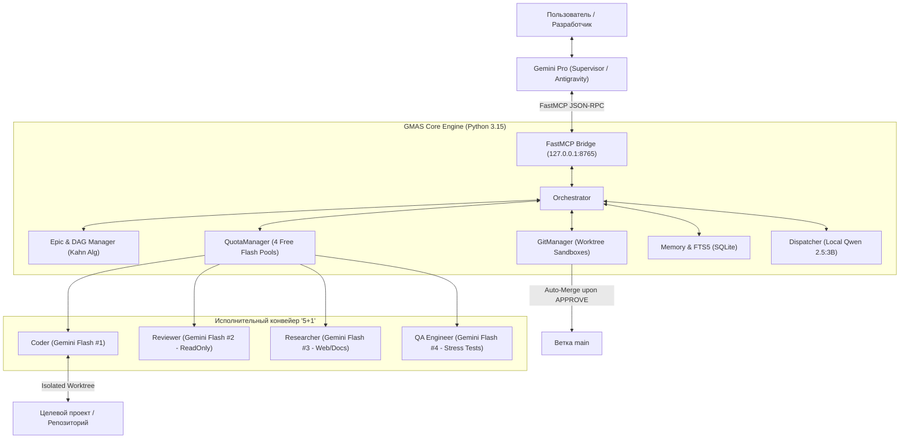

# GMAS: Архитектурный паспорт и отчет стресс-аудита
**Версия:** 2.2-Production-Audit  
**Дата верификации:** 24 октября 2026 г.  
**Среда верификации:** Windows 10/11, Python 3.15, Git 2.4x, SQLite 3 (FTS5), Ollama (Qwen 2.5:3B), FastMCP  
**Целевая аудитория:** Архитекторы ПО, Senior/Lead разработчики, исследователи автономных агентных систем (LLM-based multi-agent workflows).

---

## 1. Executive Summary: Миссия и экономика проекта

**GMAS (Gemini Multi-Agent System)** — это локально-развернутая мультиагентная среда разработки, спроектированная для решения ключевого парадокса современных LLM:  
*«Модели уровня Pro/Opus/o1 обладают выдающимися способностями планирования и архитектуры, но их постоянное использование для написания сотен строк кода и циклов тестов приводит к моментальному исчерпанию дорогих платных квот или блокировке rate-limit»*.

### Экономическая формула GMAS
* **100% мыслительного потенциала Pro-уровня**: Роль Архитектора-Супервизора (Supervisor) выполняет Google Antigravity (Gemini Pro), формулируя ТЗ, выполняя декомпозицию эпиков и принимая ключевые решения. При этом **Supervisor не генерирует программный код руками**.
* **0 руб. затрат на рутину кодогенерации**: Вся грязная работа (написание функций, отладка, прогон линтеров, модульные тесты, стресс-тесты граничных условий, аудит безопасности diff) делегируется **4 независимым бесплатным аккаунтам Gemini Flash** через балансировщик квот QuotaManager.
* **0 токенов на контекст и поиск**: Локальная легковесная модель **Qwen 2.5:3B** (через Ollama) выполняет маршрутизацию, сжатие логов pytest/flake8 и полнотекстовый FTS5-поиск по локальной памяти в SQLite.



---

## 2. Ролевая модель и разделение ответственности («5+1»)

В системе реализован принцип строгого ролевого разделения (Zero-Trust):

| Роль | Базовая LLM | Права доступа | Функция в конвейере |
|---|---|---|---|
| **Supervisor** | **Gemini Pro** (Antigravity) | Root / Orchestration | Системный архитектор. Декомпозиция Epic на Stories, утверждение merge, модерирование Арены мнений. |
| **Coder** | **Gemini Flash #1** (Free API) | Read/Write (Strict Worktree) | Автономная кодогенерация в изолированной песочнице `workspace/task_<id>`. Доступ к ОС закрыт. |
| **Reviewer** | **Gemini Flash #2** (Free API) | Read-Only | Независимый аудит безопасности, чистоты кода и проверка `git diff`. Выносит вердикт: `APPROVE` / `REVISE`. |
| **QA Engineer** | **Gemini Flash #4** (Free API) | Sandbox Test Execution | Генерация граничных тестов (boundary values, fuzzing, mocking), поиск дыр в реализации Coder. |
| **Researcher** | **Gemini Flash #3** (Free API) | Web / Docs Read-Only | Исследование библиотек, подготовка рецептов имплементации (Recipe Schema). |
| **Dispatcher** | **Qwen 2.5:3B** (Ollama Local) | Local SQLite / CPU | Сжатие гигантских stacktrace ошибок, классификация задач, FTS5-поиск релевантного контекста. |

---

## 3. Ключевые архитектурные паттерны надежности

### 3.1. Worktree Sandbox Isolation (Zero Path Traversal)
Coder не прикасается к основной ветке `main` и рабочему дереву проекта. Каждая задача выполняется в отдельном физическом Git Worktree (`workspace/task_<id>`). Инструменты песочницы (`SandboxTools`) контролируют пути, предотвращая попытки выхода вверх по дереву каталогов (`../`).

### 3.2. QuotaManager & Cross-Borrowing (Обход лимитов 429)
* Каждый бесплатный ключ Gemini Flash имеет жесткий лимит 15 RPM. QuotaManager фиксирует скользящее окно 60 секунд со строгим порогом в 14 RPM.
* При выбросе `ResourceExhausted` (429) слот ключа уходит в автоматический кулдаун на 60 секунд.
* **Перекрестное заимствование (Cross-Borrowing)**: Если лимит Coder исчерпан, система временно использует неактивную квоту QA или Researcher без остановки генерации.

### 3.3. DAG Scheduling & Collision Prevention (Алгоритм Кана)
* Декомпозиция крупных эпиков на задачи выстраивается в ациклический ориентированный граф (DAG).
* При попытке закольцевать зависимости система блокирует задачу на уровне Pydantic-валидации.
* **Блокировка файловых коллизий**: Если две независимые задачи затрагивают один и тот же файл (поле `target_files`), резолвер исключает их параллельный запуск, выстраивая в очередь во избежание мерж-конфликтов.

### 3.4. Ограниченный конвейер правок (Safe Iteration Loop)
* Цикл `Coder -> QA -> Reviewer -> Coder` жестко ограничен `max_iterations = 3`.
* Исключено зацикливание агентов. При превышении лимита задача переводится в статус `FAILED`, создается детальный диагностический отчет, а процесс останавливается.

### 3.5. Атомарное автослияние (Auto-Merge with Clean Abort)
* Перед проверкой Reviewer система принудительно делает защитный автокоммит, защищая от потери кода.
* При одобрении задачи (`APPROVE`) происходит автоматический `git merge --no-ff`.
* Если обнаруживается конфликт слияния, выполняется немедленный `git merge --abort`, рабочее дерево откатывается до идеально чистого состояния, а задача получает статус ошибки, предотвращая появление ложного `COMPLETED`.

### 3.6. Crash Recovery & Auto-Heal (Устойчивость к отключению питания)
* Все состояния, итерации и связки задач персистентны в SQLite.
* При внезапном падении процесса модуль восстановления сканирует базу, сверяет состояние файловой системы с Git worktrees и возвращает незавершенные задачи в очередь исполнения без потери смерженного прогресса.

---

## 4. Результаты эмпирического аудита (Фактические стресс-тесты)

Аудит проведен прямым запуском изолированных тестов на актуальном коде:

```
Total tests in GMAS: 136 tests
Audited Critical Chain Tests: 53 tests
Pass Rate: 100% (53/53 PASSED)
Total Execution Time: 46.69s
```

| № | Проверенная цепочка | Тестовые модули | Тестов | Результат | Время | Что подтверждено фактами |
|---|---|---|---|---|---|---|
| **1** | **Epic → Stories → DAG → Execution** | tests/test_epic_manager.py<br>tests/test_dependency_resolver.py<br>tests/test_epic_management.py | **20 / 20** | **PASSED** | 2.11s | Корректный топологический порядок; мгновенный откат при обнаружении циклов; блокировка гонок при модификации общих файлов; валидация DoD перед закрытием эпика. |
| **2** | **QuotaManager → 429 Failover** | tests/test_quota_manager.py | **6 / 6** | **PASSED** | 1.49s | Скользящее окно 14 RPM; включение 60-сек тайм-аута при получении 429; заимствование свободных квот других ключей; мягкое исключение без падения демона при исчерпании всех 4 ключей. |
| **3** | **Coder → QA → Reviewer Loop** | tests/test_qa_agent.py<br>tests/test_agents.py<br>tests/test_orchestrator.py | **14 / 14** | **PASSED** | 24.72s | Полная изоляция песочницы; передача замечаний QA в промпт Coder; успешное прохождение цикла правок с лимитом 3 итерации. |
| **4** | **APPROVE → Auto-Merge** | tests/test_git_manager.py<br>tests/test_safety_epic_pipeline.py | **11 / 11** | **PASSED** | 17.76s | Защитный автокоммит при незафиксированных правках; чистый `git merge --abort` при конфликтах без загрязнения `main`; предотвращение ложного `COMPLETED` при ошибке слияния. |
| **5** | **Crash Recovery & Auto-Heal** | tests/test_epic_recovery.py | **2 / 2** | **PASSED** | 0.61s | Обнаружение висячих задач и прерванных ворктри после перезапуска; авто-восстановление в рабочее состояние без ручного вмешательства. |

---

## 5. Архитектурная карта модулей репозитория

```
GMAS/
├── bridge/                     # FastMCP интеграционный слой с Antigravity
│   └── mcp_server.py           # 15 MCP-инструментов (delegate_task, plan_epic, execute_epic_batch...)
├── core/                       # Ядро системы (Control Plane)
│   ├── orchestrator.py         # Координация жизненного цикла Coder ↔ Reviewer ↔ QA
│   ├── epic_manager.py         # Управление эпиками, историями, DoD и каскадным удалением
│   ├── dependency_resolver.py  # DAG планировщик на алгоритме Кана с детекцией коллизий
│   ├── quota_manager.py        # Балансировщик 4 ключей Gemini Flash (RPM, Cross-Borrowing, 429)
│   ├── git_manager.py          # Управление изолированными Git Worktrees и автослиянием
│   ├── epic_recovery.py        # Модуль аварийного восстановления после сбоев
│   ├── arena.py                # Модуль дебатов субагентов при архитектурных развилках
│   ├── memory_manager.py       # Долговременная память решений (SQLite FTS5)
│   └── scheduler.py            # Фоновый планировщик оптимизации БД и ночной рефлексии
├── agents/                     # Агентный уровень (Data Plane)
│   ├── coder/                  # Логика и промпты Coder (Gemini Flash #1)
│   ├── reviewer/               # Логика Reviewer (Gemini Flash #2 - Read-Only)
│   ├── qa/                     # Генератор стресс-тестов QA (Gemini Flash #4)
│   ├── researcher/             # Сборщик документации Researcher (Gemini Flash #3)
│   └── dispatcher_qwen/        # Локальный диспетчер контекста (Ollama Qwen 2.5:3B)
├── web/                        # Панель мониторинга и REST API
│   ├── app.py                  # FastAPI/Flask веб-приложение
│   └── templates/              # Real-time Web Dashboard (DAG визуализация, квоты)
└── tests/                      # 136 модульных и интеграционных тестов
```

---

## 6. Вопросы и развилки для внешнего эксперта / архитектора

При демонстрации данной системы стороннему специалисту рекомендуется обратить внимание на следующие проектные вызовы:

1. **Стратегия параллелизма ворктри**:
   * *Текущее состояние*: DAG запускает задачи параллельно, если их `target_files` не пересекаются.
   * *Вопрос к архитектору*: Стоит ли вводить динамический статический анализ AST (Abstract Syntax Tree) перед запуском, чтобы проверять пересечения импортов и символов (функций, классов), а не только имен файлов?
2. **Многоуровневая память и векторное представление**:
   * *Текущее состояние*: Полнотекстовый поиск SQLite FTS5 + суммаризация через Qwen 2.5:3B.
   * *Вопрос к архитектору*: Имеет ли смысл внедрять локальные эмбеддинги (например, `all-MiniLM-L6-v2` / `nomic-embed-text`) для семантического поиска прошлых архитектурных решений, или связка FTS5 + BM25 достаточна для кодовой базы?
3. **Обработка критических конфликтов слияния (Git Conflict Resolution)**:
   * *Текущее состояние*: При конфликте слияния система делает `merge --abort` и требует внимания разработчика.
   * *Вопрос к архитектору*: Целесообразно ли выделять отдельную суброль («Merge Agent» на базе Flash) для автоматического разрешения тривиальных текстовых конфликтов через анализ diff обеих веток?
4. **Контроль деградации контекста (Context Window Budgeting)**:
   * *Текущее состояние*: Диспетчер Qwen агрессивно вырезает дублирующиеся трейсы и оставляет только скелеты файлов (`extract_skeleton_structure`).
   * *Вопрос к архитектору*: Какие дополнительные эвристики сжатия контекста кода доказали свою эффективность в вашей практике?
